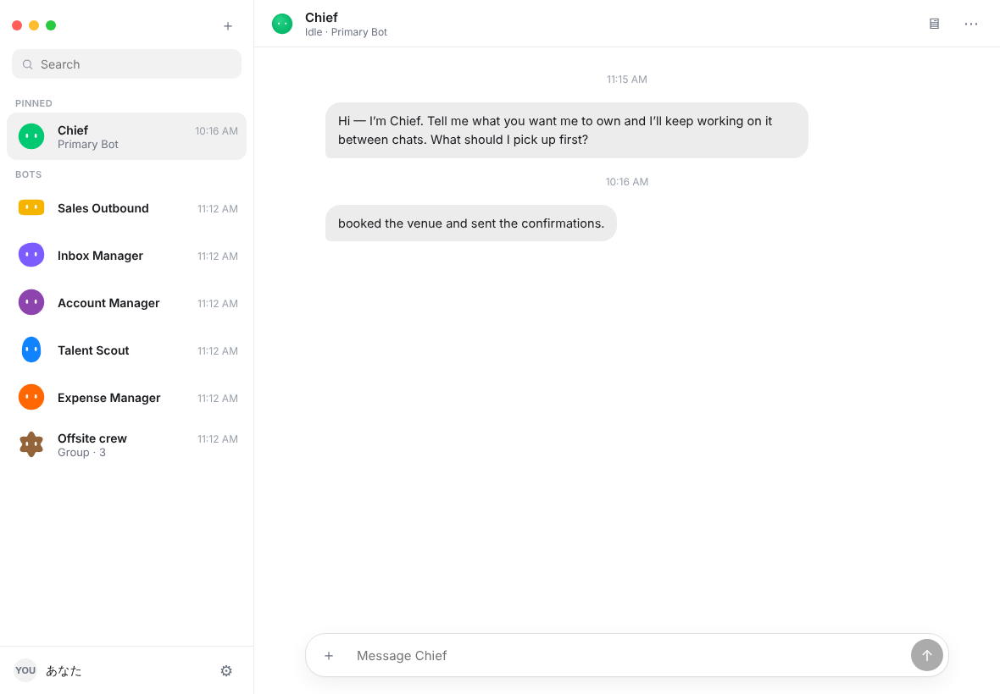

# GODAgent

A faithful, **working** recreation of the Grok Bot experience: persistent AI
teammates ("Bots") that each have an animated avatar, long‑term memory, a shared
cloud computer, routines, skills and approval‑gated actions — in a desktop‑style
three‑pane UI with light/dark themes, a mobile layout and PWA/offline support.

This is a recreation study, not a clone of any proprietary assets. Avatars are
**original abstract shapes** (the "expressive eyes on a simple shape" idea), the
app's local web fixtures are generic, and no brand logos, characters, fonts or
copy are copied. Private internals (the real model, servers, infra) are
**re‑implemented** with equivalent behaviour and clearly labelled as such — see
[`docs/COMPARISON.md`](docs/COMPARISON.md).



## What actually works

- **Bots** — create / edit / delete, pin, hide, rename, titles; persistent
  conversations that survive restarts (JSON store on disk).
- **Avatars** — a canvas engine with **12 shapes** (blob, circle, capsule,
  triangle, teardrop, flower, square, sparkle, clover, heart, house, star),
  per‑Bot colour, pointer‑tracking gaze, blinking, shape **morphing**, and the
  **six states** (idle · thinking · working · waiting · blocked · done), each
  carried by the avatar's eyes/pose. Shape / Generate / Upload editor.
- **Chat** — streaming replies (token by token), time separators, the black
  user bubble + grey bot bubbles, stop button, file attach (25 MB limit).
- **In‑chat cards** — computer, approval, question/choice, email draft, memory,
  handoff, file, error, routine‑run — all interactive and wired to real logic.
- **The computer** — a **real headless Chromium** (Playwright) that navigates,
  clicks, scrolls and screenshots locally‑served web apps. Status / Preview /
  **Takeover**. If Chromium can't start, the panel says so honestly (no faked
  frames).
- **Approvals** — Allow once / Always allow / Deny, Auto Review, saved rules
  (cap of 20, oldest evicted), auto‑approval by rule.
- **Memory** — per‑Bot durable facts/preferences/instructions; add, view, forget.
- **Groups** — 2–6 member group chats with Bot‑to‑Bot handoff.
- **Routines** — time / daily / weekly / monthly / interval schedules (plus
  webhook/email/github/slack trigger endpoints), run history, manual run,
  enable/disable, linked to skills.
- **Skills** — account‑ or bot‑scoped reusable procedures.
- **Connect Apps** — a marketplace (Gmail, Slack, GitHub, Linear, Salesforce …)
  with connect / disconnect and exposed tools.
- **Settings** — Account, Appearance (light/dark/system), Language, Computer,
  Bot/Primary, Timezone, Auto Review, Custom Rules, Connect Apps, Skills, Vault,
  Notifications, Updates.
- **Two engines** — offline **simulation** (default, no key) drives every
  feature; set `ANTHROPIC_API_KEY` to switch to a **live Claude agent loop**
  that uses the same tools.

## Architecture

```
web/     Vite + React + TypeScript SPA   (avatar engine, UI, PWA)
server/  Node + Express (ESM)            (JSON store, agent loop, tools,
         real Playwright computer, routine scheduler, SSE live stream)
```

The server serves REST + an SSE live stream and, in production, the built SPA.
Everything is persisted to `server/data/store.json`.

## Run it

Requires Node 20+. From the repo root:

```bash
# install everything
npm install
npm --prefix web install
npm --prefix server install

# option A — production: build the SPA, then start the server (serves it)
npm run build
npm start                     # → http://localhost:8787

# option B — development: Vite + server with hot reload
npm run dev                   # web on :5173 (proxies /api to :8787)
```

Open **http://localhost:8787** (prod) or **http://localhost:5173** (dev).

### Live model (optional)

```bash
export ANTHROPIC_API_KEY=sk-ant-...
export GODAGENT_MODEL=claude-opus-4-8   # optional; defaults to this
npm start
```

Without a key the app runs the built‑in simulation engine — fully functional
and offline‑capable.

### The computer

The Playwright Chromium is launched automatically. In some sandboxes it needs an
explicit binary; the server already falls back to `/opt/pw-browsers/chromium`.
If it still can't start, the Computer panel reports it as unavailable rather than
showing a fake screen.

## Tests

```bash
npm --prefix server test          # Node API tests (9)
npm --prefix web run build        # type-check + build
npm --prefix web run test:e2e     # Playwright E2E (6) — builds SPA first
```

See [`docs/TEST-RESULTS.md`](docs/TEST-RESULTS.md) and the screen‑by‑screen
[`docs/COMPARISON.md`](docs/COMPARISON.md).

## Not included / re‑implemented

- Real third‑party OAuth, real email send, real external browsing (sandboxed).
- Image‑generation for avatars (Generate picks a shape+colour from the prompt
  deterministically and says so).
- The proprietary model/infra — replaced by the simulation engine or your own
  Claude key.
